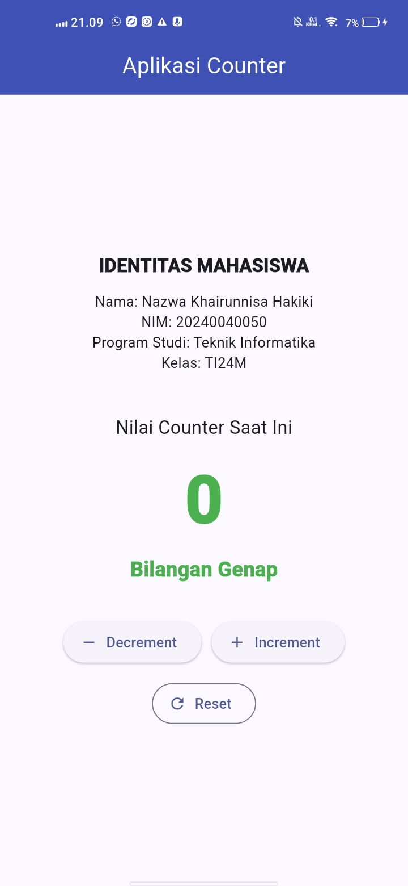
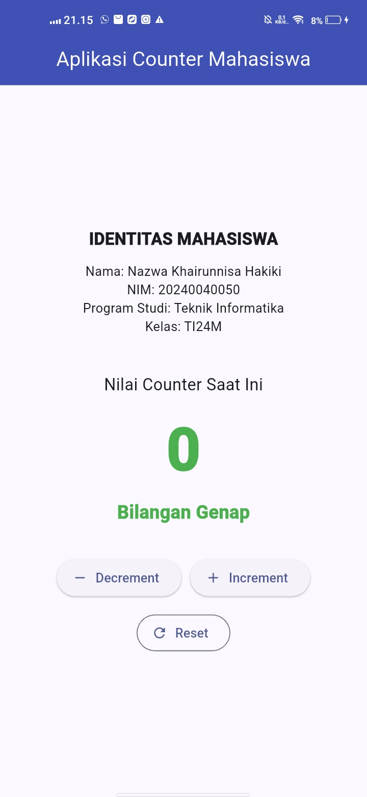
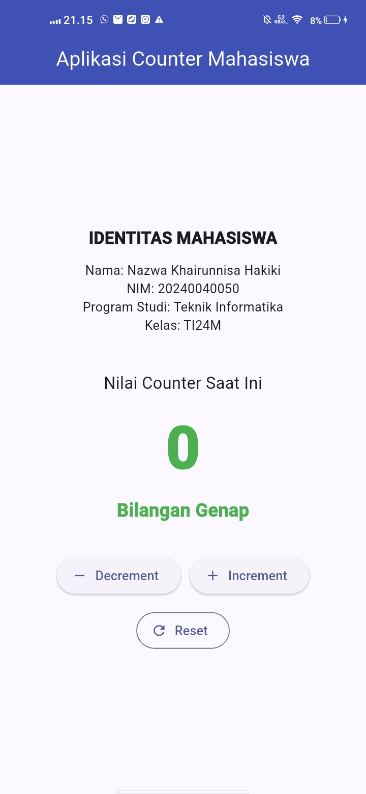
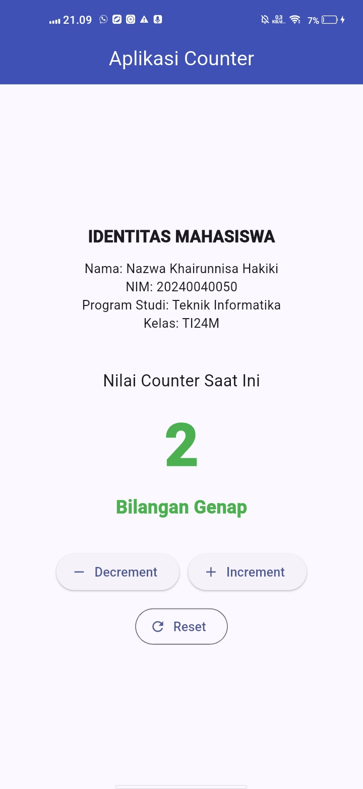
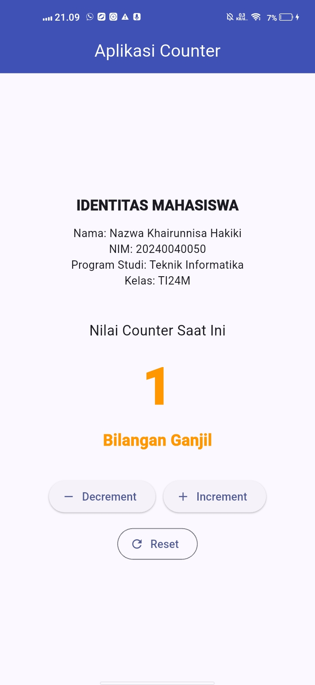
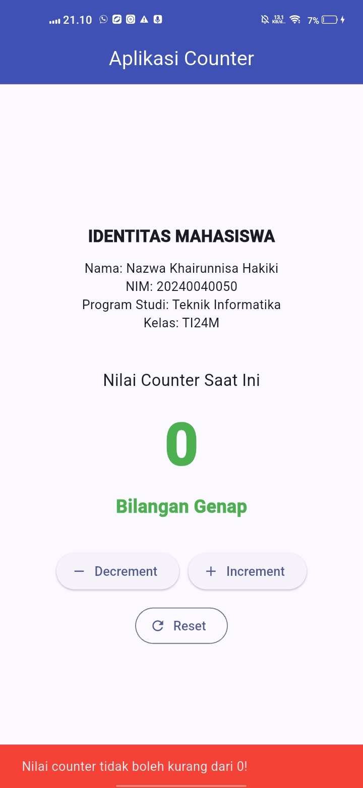
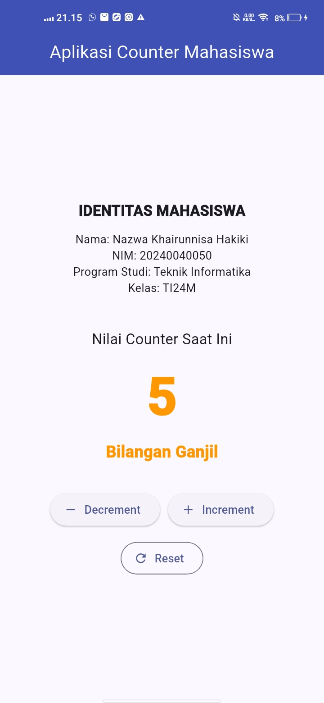

# PPM Sesi 2 - Product & Profile

## Praktikum Pemrograman Mobile

Aplikasi **Product & Profile** merupakan project tugas Praktikum Pemrograman Mobile Sesi 2 yang dibuat menggunakan Flutter dan bahasa pemrograman Dart.

Aplikasi ini menampilkan informasi profil mahasiswa dan produk sederhana dengan fitur interaktif seperti Favorite, pengaturan jumlah produk, perhitungan total harga, dan tombol tambah ke keranjang.

## Identitas Mahasiswa

| Keterangan | Data |
|---|---|
| Nama | Nazwa Khairunnisa Hakiki |
| NIM | 20240040050 |
| Program Studi | Teknik Informatika |
| Kelas | TI24M |

## Fitur Aplikasi

1. **AppBar** menampilkan judul PPM Sesi 2 beserta nama dan NIM mahasiswa.
2. **Profil Mahasiswa** menampilkan nama, NIM, program studi, kelas, foto profil, dan lima ikon bintang.
3. **Kartu Produk** menampilkan gambar produk, nama produk, harga, dan kategori.
4. **Favorite** mengubah ikon hati ketika ditekan dan memperbarui jumlah Like.
5. **Pengaturan Jumlah Produk** menggunakan tombol tambah (+) dan kurang (-), dengan jumlah minimal satu.
6. **Total Harga** berubah sesuai jumlah produk yang dipilih.
7. **Tambah ke Keranjang** menampilkan notifikasi SnackBar ketika tombol ditekan.
8. **Banner Promo** dibuat menggunakan widget Stack dan Positioned.

## Widget Flutter yang Digunakan

- Scaffold
- AppBar
- Row
- Column
- Container
- Card
- Stack
- Positioned
- Icon
- Button
- StatelessWidget
- StatefulWidget

## Teknologi yang Digunakan

- Flutter
- Dart
- Visual Studio Code

## Screenshot Aplikasi

### Screenshot 1


### Screenshot 2


### Screenshot 3


### Screenshot 4


### Screenshot 5


### Screenshot 6


### Screenshot 7


### Screenshot 8


## Struktur Project

```text
ppm_sesi2/
├── images/
│   ├── profil.jpg
│   ├── tas.jpg
│   ├── img1.JPG
│   ├── img2.JPG
│   ├── img3.JPG
│   ├── img4.JPG
│   ├── img5.JPG
│   ├── img6.JPG
│   ├── img7.JPG
│   └── img8.JPG
├── lib/
│   └── main.dart
├── pubspec.yaml
└── README.md
```

## Cara Menjalankan Project

1. Clone repository GitHub.
2. Buka folder project menggunakan Visual Studio Code.
3. Jalankan perintah berikut di terminal:

```bash
flutter pub get
```

4. Jalankan aplikasi menggunakan perintah:

```bash
flutter run
```

## Repository GitHub

[PPM Sesi 2 - Product & Profile](https://github.com/refza321/ppm-sesi2)

---

**Praktikum Pemrograman Mobile - Sesi 2**  
Teknik Informatika - TI24M